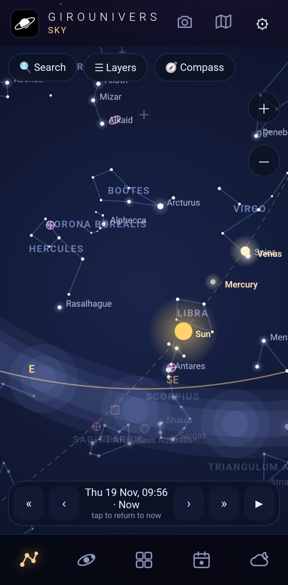
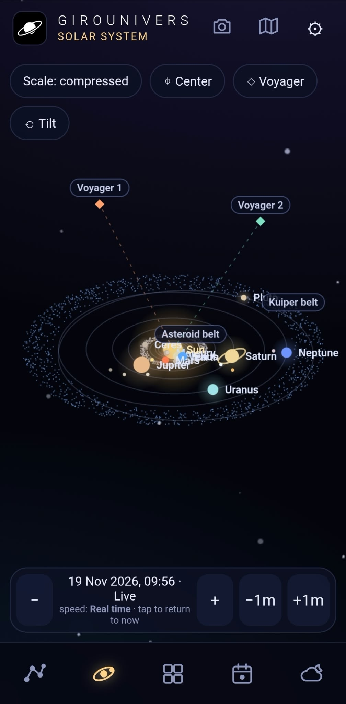
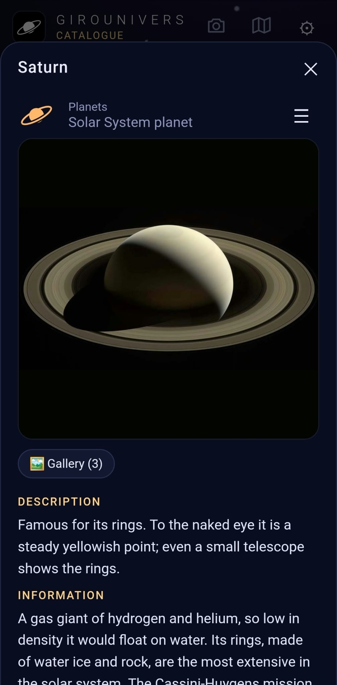
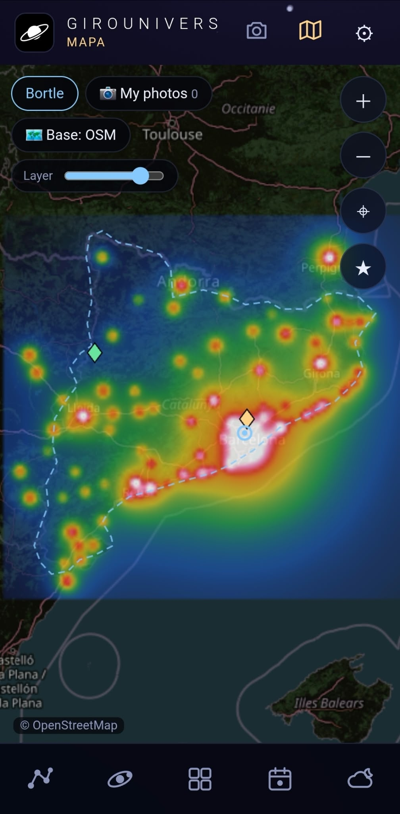

# Girounivers

A personal astronomy app with a dark, minimalist universe look. It brings together a live sky map, an interactive solar system, an editable catalogue with your own photos, photo challenges, a cosmic events agenda, an observing weather forecast and a light pollution map.

It runs as an Android app (APK) and as a web app you can add to your iPhone home screen. Almost everything works offline, and all your data stays on your device.

## Screenshots

| Sky map | Solar system | Catalogue card | Map |
|---|---|---|---|
|  |  |  |  |

## Features

### Sky map
- Real-time map of the sky for your location, with stars, constellations and deep-sky objects.
- Jump from any catalogue card straight to the object in the sky.

### Solar system
- Interactive, real-time model of the solar system: planets, their main moons and the asteroid belt.
- Includes the dwarf planets Ceres and Pluto, plus markers for the Voyager 1 and Voyager 2 probes.

### Catalogue
- Hundreds of ready-made cards: planets, moons, stars, constellations, galaxies, nebulae, clusters, black holes and the Messier catalogue.
- Every card has a description, information and history/mythology (Spanish and English), and you can edit any of it.
- Magazine-style card layout: a large cover photo with the information and data beside it, plus a gallery for the rest of your photos.
- Group by type, sort A–Z or by constellation, and search.
- Your own notes per card, shown only when you want them.

### Photos
- Add photos from your phone, with in-app crop, move, zoom and rotate (optional grid).
- Date, location and place name for each photo.
- Swipe left and right to move between photos.
- Pick the photo location on the built-in map, or choose one of your saved observing spots.
- Choose the cover photo of each card.

### Photo challenges
- A camera section with astrophotography challenges to try.

### Agenda
- Upcoming cosmic events: oppositions, conjunctions, eclipses, quadratures, stationary points, perihelion and aphelion, supermoons and more.
- Add your own events.
- Android notifications for the agenda (the same day, the evening before, or one hour before).

### Weather
- Forecast tailored to stargazing, with a score for each night, based on Open-Meteo. This is the only section that needs internet.

### Map
- Light pollution map of Catalonia with the Bortle scale and the sky brightness at any point.
- Base maps: OpenStreetMap, ICGC topographic and satellite imagery.
- Optional layer with the places where you took your photos. Tap a point to see the objects photographed there, then open each object's gallery.
- Save your own observing spots and use them when assigning a location to a photo.

### Backup and languages
- Export and import a full backup: cards, photos, locations, spots and settings.
- Spanish and English.

## Getting the app

**Android.** Download the latest `Girounivers-vX.Y.apk` from the [Releases](../../releases) page and install it. New versions install over the old one and keep your data.

**iPhone.** Open the web version in Safari, tap Share, then "Add to Home Screen":
`https://mgiroo1.github.io/girounivers-app/`

On the web version there are no agenda notifications, and data lives in the browser, so use the backup option regularly.

## Privacy

Photos, notes and settings are stored only on your device. The app uses the internet only for map tiles and the weather forecast.

## Project structure

```
app/src/main/assets/www/    web interface (index.html, js/, css/, icons/)
app/src/main/java/          Android code (WebView, photo picker, notifications)
.github/workflows/          automatic builds: APK release and iPhone web version
```

## Tech

- Android WebView wrapper (Java) around a plain HTML, CSS and JavaScript app, with no framework.
- Local storage in IndexedDB, and a service worker for offline use.
- Android local notifications with `AlarmManager`.
- The Bortle model is an estimate computed from a table of towns and cities; it is meant as a guide, not a measurement.

## Credits

Map data © [OpenStreetMap](https://www.openstreetmap.org/copyright) contributors, [ICGC](https://www.icgc.cat/), Esri World Imagery. Weather by [Open-Meteo](https://open-meteo.com/).
