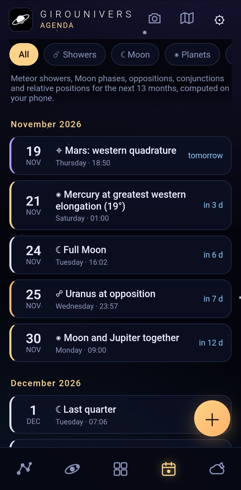

# Agenda

[← Back to the README](../../README.md)

A calendar of cosmic events, calculated by the app itself, so it works offline.

- **Oppositions**, conjunctions, eclipses, quadratures, stationary points, perihelion and aphelion, supermoons and more.
- Add your **own events**.
- **Android notifications**: choose to be notified the same day, the evening before, or one hour before, and choose which types of event to include.
- Notifications are not available in the iPhone web version.
