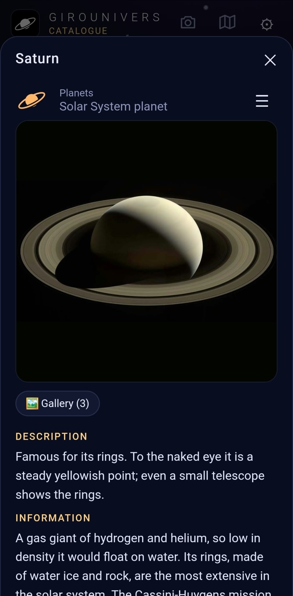

# Catalogue

[← Back to the README](../../README.md)

Hundreds of ready-made cards for the objects you may want to observe: planets, moons, stars, constellations, galaxies, nebulae, star clusters, black holes and the Messier catalogue.

- **Magazine-style cards**: a large cover photo, with the description, information, history/mythology and data beside it (or below it on a narrow screen).
- **Gallery** button on each card with all your photos of that object.
- **Group** the catalogue by type, or sort it A–Z or by constellation, and search by name.
- Every card comes with text in Spanish and English. Anything you write yourself takes priority, and you can edit every field.
- Create your own cards for objects that are not in the catalogue.
- Personal **notes** per card, which you can show or hide from the card menu (☰).
