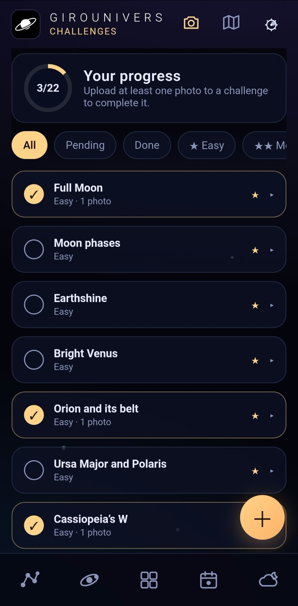

# Photo challenges

[← Back to the README](../../README.md)

<table>
<tr>
<td width="290" valign="top">

</td>
<td valign="top">

A camera section, opened from the icon in the top bar, with astrophotography challenges to try.

- Take on a challenge and add your photo to it.
- Photos taken for a challenge are kept together with the rest of your photos.
- Works offline.

</td>
</tr>
</table>
