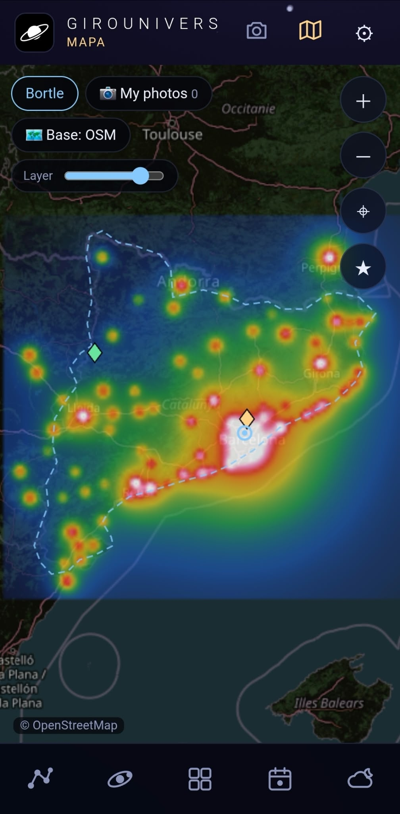

# Map

[← Back to the README](../../README.md)

A light pollution map of Catalonia, opened from the map icon in the top bar.

- The **Bortle scale** and an estimate of the sky brightness at any point you tap.
- **Base maps**: OpenStreetMap, ICGC topographic and satellite imagery.
- **My photos** (off by default): shows where you took your photos. Tap a point to see the objects photographed there, then open the gallery of each one.
- **Observing spots**: save your own places and use them when assigning a location to a photo.
- The Bortle layer is an estimate computed from a table of towns and cities. Use it as a guide, not as a measurement.
