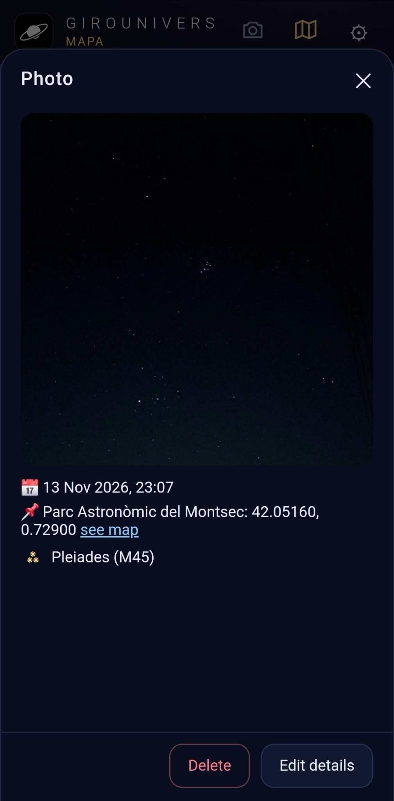

# Photos

[← Back to the README](../../README.md)

Keep your own photos of every object, with the details of where and when you took them.

- **Add photos** from your phone, and crop, move, zoom or rotate them inside the app (the grid is optional).
- **Swipe** left and right to move between the photos of an object.
- Each photo stores its **date**, **location** and **place name**. Tap *see map* to open that spot on the app's own map.
- Set the location by typing it, using your current position, picking it on the map, or choosing one of your saved **observing spots**.
- Each photo shows the object it belongs to, with its symbol and colour.
- Choose which photo is the **cover** of each card. It is shown first in the gallery.
- Notes are optional: add them only when you want them.
