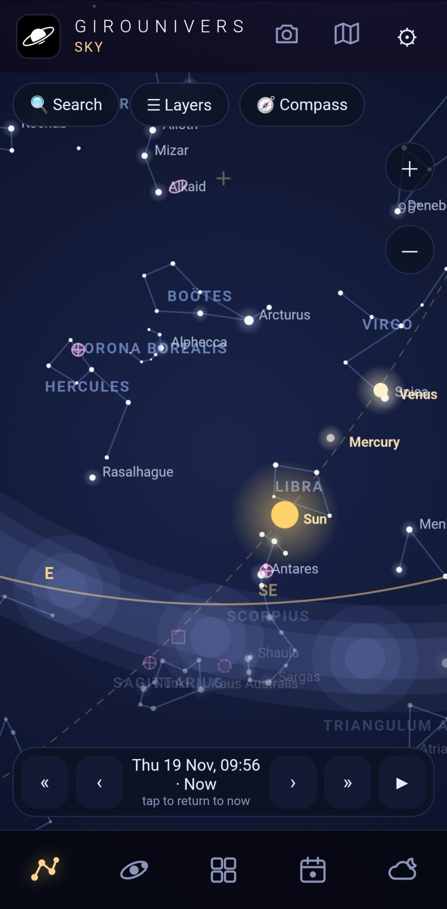

# Sky map

[← Back to the README](../../README.md)

<table>
<tr>
<td width="290" valign="top">

</td>
<td valign="top">

A real-time map of the sky for your location, showing stars, constellations and deep-sky objects.

- **Search** for any object in the catalogue and see where it is.
- **Layers** let you show or hide constellation lines, names and other elements.
- **Compass** mode points the map the way you are facing.
- From any catalogue card, use the menu (☰) and choose **See in the sky** to jump straight to that object.
- Works offline.

</td>
</tr>
</table>
