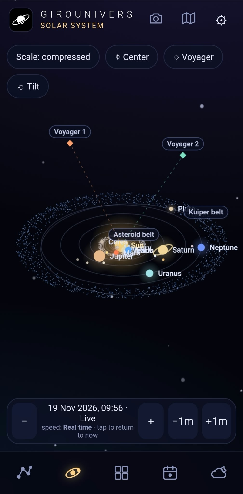

# Solar system

[← Back to the README](../../README.md)

An interactive model of the solar system that follows the real date and time.

- The eight planets, their main moons and the asteroid belt.
- The dwarf planets **Ceres** and **Pluto**.
- Markers for the **Voyager 1** and **Voyager 2** probes, with their approximate distance from the Sun.
- Pan and zoom freely, and tap any body to open its catalogue card.
- From a card, choose **See in the solar system** in the menu (☰) to jump to that body.
- Works offline.
