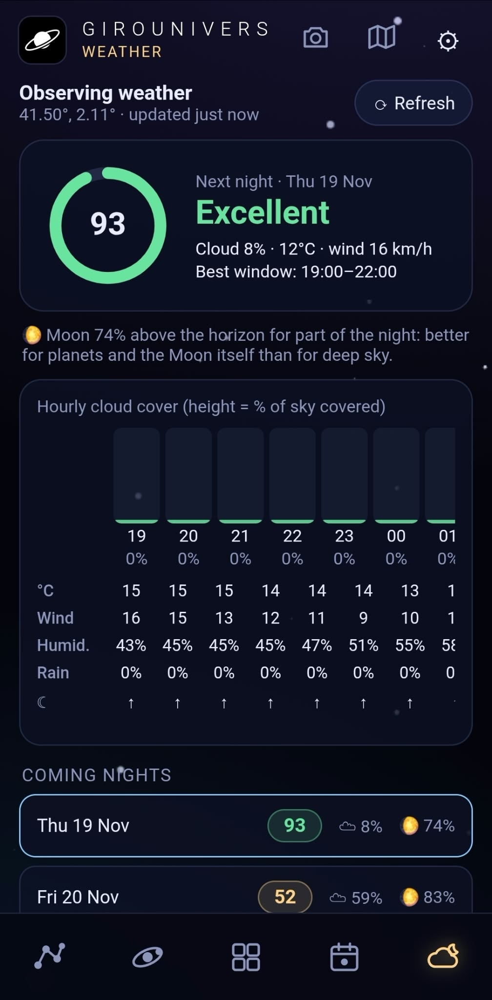

# Weather

[← Back to the README](../../README.md)

A forecast made for stargazing, to help you decide whether it is worth going out tonight.

- A score for each night, based on cloud cover and the hours of astronomical darkness.
- Uses [Open-Meteo](https://open-meteo.com/). This is the only section that needs an internet connection.
